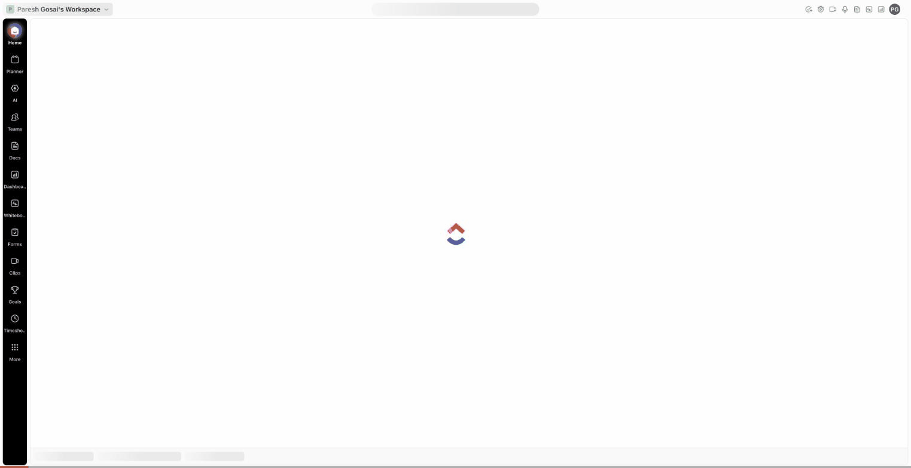
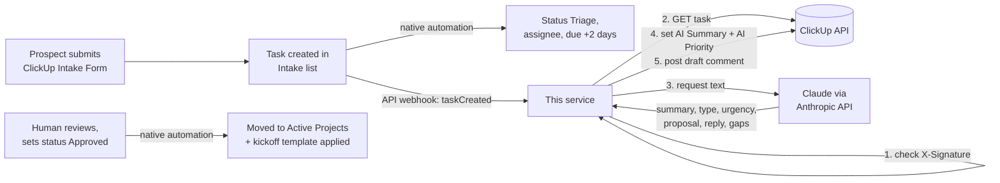

# ClickUp Inbox-to-Action

An AI triage layer for ClickUp client intake. A prospect fills in the intake form, ClickUp creates a task, and within seconds that task has a 3-line AI summary, an AI priority, and a comment holding a draft proposal outline, a draft reply email and a list of what's still missing. A human reviews it and moves the task on. Nothing goes to the client automatically.




*A real run on a Free Forever workspace with a fictional enquiry: form submitted, task triaged by ClickUp's own automation, summary/priority/comment written by the service in about 11 seconds, then approved and moved to Active Projects with the kickoff checklist.*

## How it works



1. A webhook registered through the ClickUp API fires on `taskCreated` for the Intake list.
2. The service checks the `X-Signature` header (HMAC-SHA256 of the raw body with the webhook's secret), queues the event and answers `200` straight away.
3. A background worker fetches the full task, flattens the form answers into plain text, and asks Claude for a structured triage: 3-line summary, service type, urgency with a reason, proposal outline, polite reply email, missing information.
4. It writes the summary into the **AI Summary** field, picks the matching option in the **AI Priority** dropdown, and posts the rest as a task comment.
5. Approval stays human: moving the task to `Approved` fires ClickUp's own automations (move to Active Projects, apply the kickoff checklist template).

## Why this design

- **Webhook via the API, not a ClickUp automation.** ClickUp's "Call webhook" automation action is only on the Business plan and above. Webhooks created through the public API work on every plan, including Free Forever, so this is the route that works for small clients.
- **Answer fast, work in the background.** ClickUp marks a webhook as failing if the reply takes longer than 7 seconds, and an LLM call can take longer than that. The handler only verifies and queues; the slow part runs on a worker thread.
- **Signature check on every request.** Without it, anyone who found the URL could post fake events and make the service write into the workspace. A bad signature gets `403`, not `401`, because ClickUp suspends a webhook the moment it sees a `401`, so one wrong secret would switch the integration off.
- **Safe on retries.** ClickUp retries a failed delivery up to 5 times. The service skips a task whose AI Summary is already filled, and ignores subtasks and tasks outside the Intake list, so the same enquiry is never triaged twice.
- **Form text is treated as data.** The request is wrapped in tags and the model is told never to follow instructions inside it, never to promise prices or dates, and its output is constrained to a JSON schema.
- **Swappable AI.** The pipeline only needs an object with a `triage()` method. `AnthropicTriager` is the default; replacing it with another provider is one small class.
- **Minimal dependencies.** Standard-library HTTP server and ClickUp client; the only package is the Anthropic SDK.

## Run it without a ClickUp account (dry run)

```bash
python -m venv .venv && source .venv/bin/activate
pip install -r requirements.txt -r requirements-dev.txt

python dry_run.py --offline     # whole pipeline on samples/, canned AI step, no keys needed
export ANTHROPIC_API_KEY=...    # optional
python dry_run.py               # same, with a real Claude call
pytest                          # 16 tests, ClickUp API and Claude mocked
```

The dry run signs the sample webhook the way ClickUp does, verifies it, runs the pipeline against a sample task (a fictional dental group, not a real client), prints every ClickUp write it would make, then replays the same event to show the retry guard.

## Run it for real

```bash
cp .env.example .env                       # add CLICKUP_API_TOKEN and ANTHROPIC_API_KEY
python setup_fields.py --workspaces        # prints CLICKUP_TEAM_ID
# add CLICKUP_INTAKE_LIST_ID (the number in the Intake list URL)
python setup_fields.py                     # checks the fields, prints their IDs for .env
python -m inbox_to_action.server           # listens on :8000/clickup/webhook
# expose it over HTTPS (e.g. Cloudflare Tunnel or ngrok), then:
python register_webhook.py --endpoint https://<public-url>/clickup/webhook
python register_webhook.py --list          # shows webhook health and fail count
```

`register_webhook.py` writes the webhook's signing secret straight into `.env`; its value is never printed. The ClickUp side (Space, Lists, fields, form, automations, template, dashboard) is set up by hand once; [WORKSPACE-BUILD-GUIDE.md](WORKSPACE-BUILD-GUIDE.md) has the click-by-click steps. ClickUp's API can fill custom fields but has no endpoint to create them, so `setup_fields.py` maps them by name instead.

## Free plan limits (honest notes)

Checked against ClickUp's help centre and API docs in October 2026:

- **Custom Field uses: 60, lifetime, per workspace.** Every value set on a task counts, whether a person, a form or the API sets it. This service uses 2 per enquiry (AI Summary, AI Priority), plus whatever custom fields the form fills. That is enough for a demo and a handful of real enquiries, not for production. Leave a field ID blank in `.env` and that write is skipped; `POST_COMMENT` alone costs nothing.
- **Forms: one per Free workspace**, and sharing, embedding and exporting forms is not available on Free. A public intake link needs the Unlimited plan or above; on Free the form is filled in from inside ClickUp.
- **Automations: 5 active, 100 actions a month.** The build uses 2 or 3.
- **Dashboards: 60 lifetime uses, and viewing one counts.** Dashboards can't be shared outside the workspace on any plan, so the demo uses screenshots.
- On any paid plan these limits go away or rise sharply, and the code doesn't change.

## Security

- Secrets (ClickUp token, webhook secret, Anthropic key) live only in environment variables or a local `.env`, which is git-ignored. `.env.example` holds placeholders only.
- Every webhook request is verified with a constant-time HMAC comparison before anything is parsed or queued. Bodies over 1 MB are refused.
- The model writes drafts only. Nothing is emailed, and no status is changed, without a person doing it.
- A ClickUp personal token has the same access as its user. For client work, use a dedicated ClickUp user with access only to the delivery Space.

## Status

Built, tested and run live end to end (27 October 2026) on a ClickUp Free Forever workspace:

- 16 unit and integration tests pass (ClickUp API and Claude mocked); the offline dry run works with no accounts.
- Live run: a fictional enquiry submitted through the ClickUp form produced a task in Intake; ClickUp's own automation set status, assignee and a due date; the webhook reached this service through a Cloudflare tunnel; Claude (Sonnet 5.5) returned a structured triage in about 11 seconds; the service filled **AI Summary** and **AI Priority** and posted the draft comment. Approving the task applied the kickoff template, moved it to Active Projects and assigned it.
- Found on the way: ClickUp's "Apply template" action clears the task's assignee, so the approval automation re-assigns after applying it (see the guide).
- Not covered: load, concurrent submissions and long-running hosting. The demo runs on a laptop behind a temporary tunnel; real client use would sit on a small always-on server.

## Stack

Python · ClickUp API v2 (webhooks, tasks, custom fields, comments) · Anthropic Claude API (structured outputs) · pytest

---
Part of a small portfolio of tested automation/AI builds; see [ParishSynthMind](https://github.com/ParishSynthMind) for the others.
